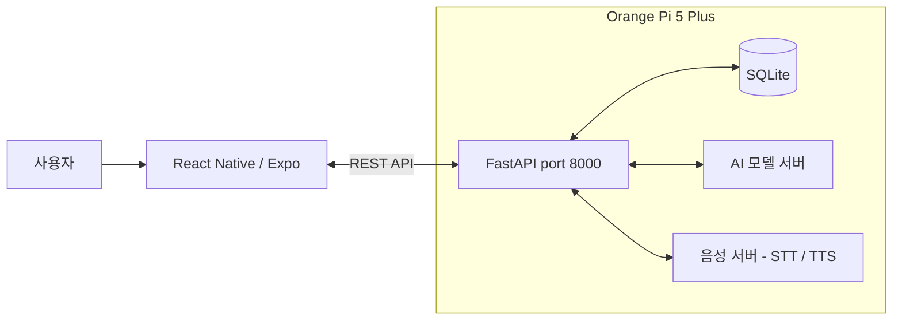
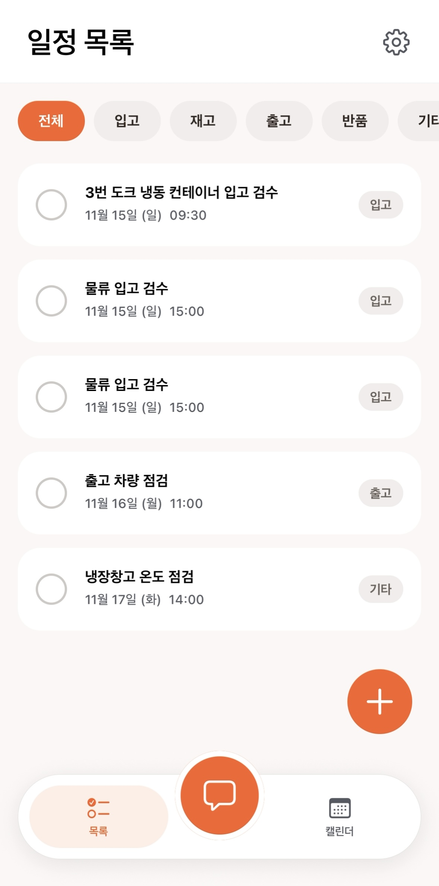
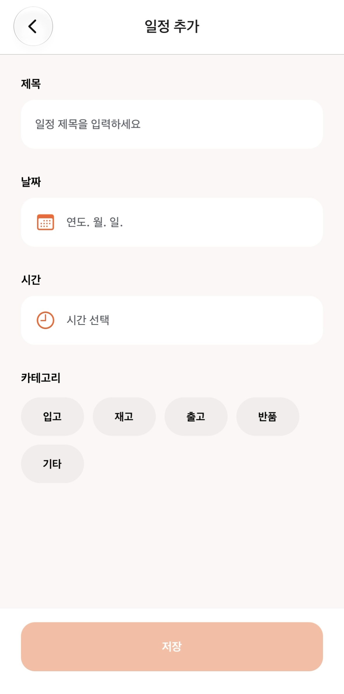
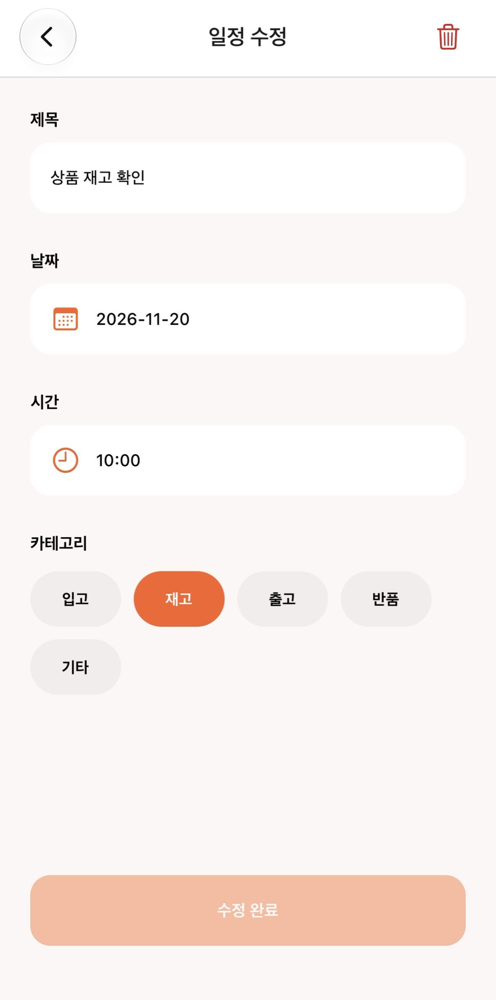
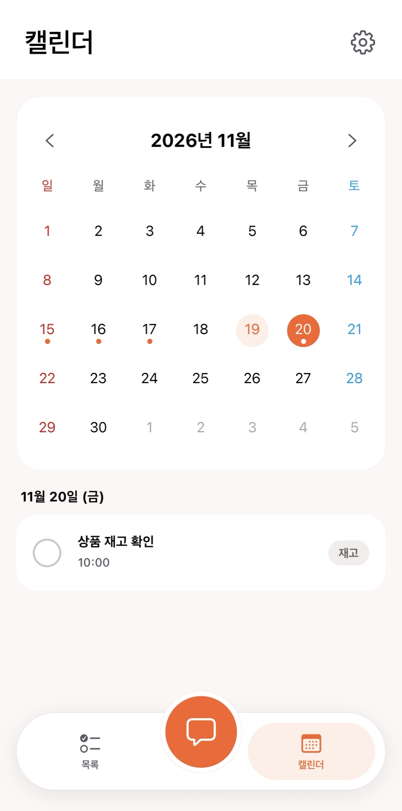
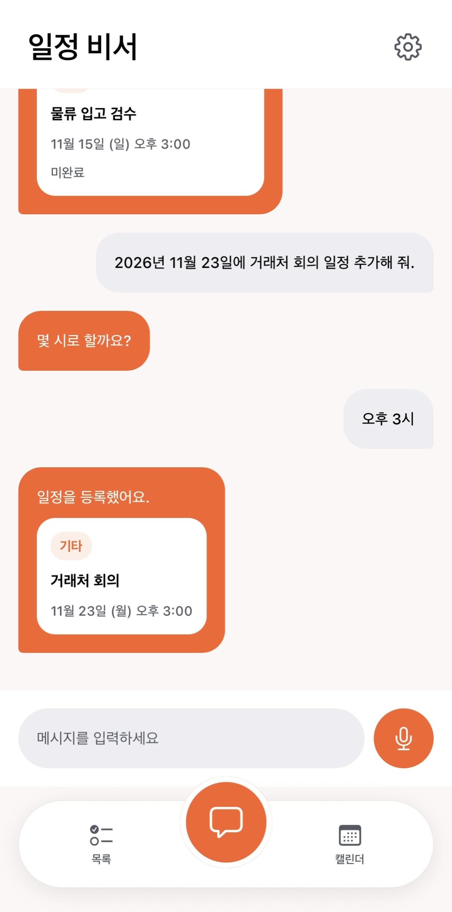
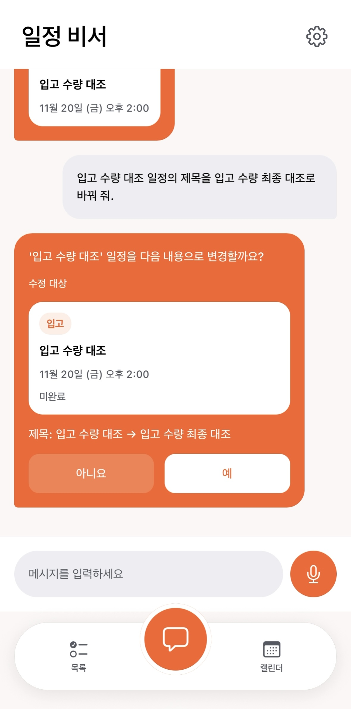
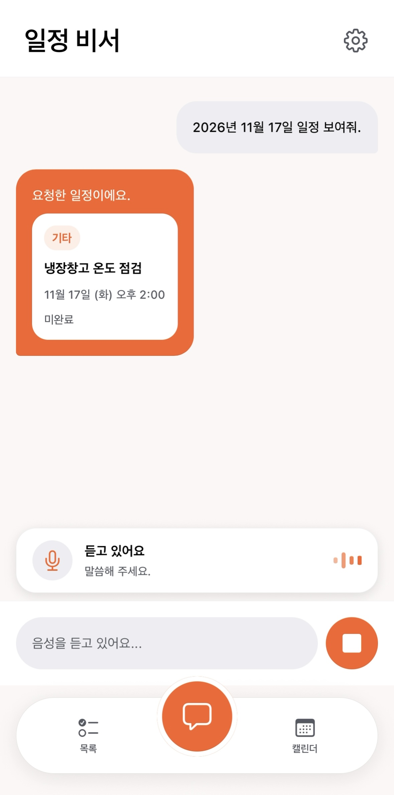
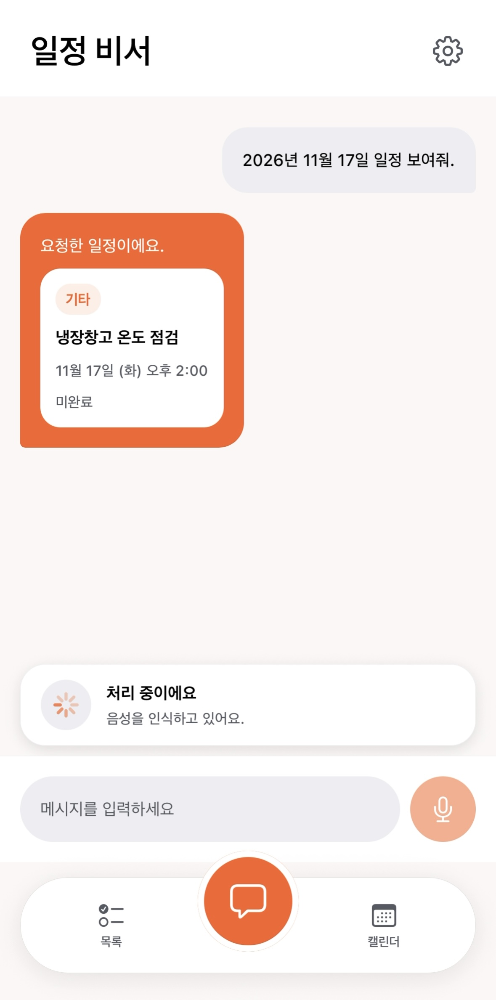

# 너만의 비서 Frontend

물류창고 작업 비서 **너만의 비서**의 모바일 프론트엔드입니다. React Native와 Expo를 기반으로 일정 관리, 텍스트 및 음성 AI 비서, Orange Pi 연결 기능을 제공합니다.

---

## 기술 스택


| 구분              | 기술                                                   |
| ----------------- | ------------------------------------------------------ |
| 언어              | TypeScript                                             |
| 프레임워크        | React Native 0.88 / Expo SDK 58                        |
| UI 라이브러리     | React 19                                               |
| 라우팅            | Expo Router                                            |
| 상태 관리         | Zustand 5                                              |
| 로컬 저장소       | AsyncStorage                                           |
| 캘린더            | react-native-calendars                                 |
| 날짜 및 시간 선택 | @expo/ui                                               |
| 음성 녹음 및 재생 | expo-audio                                             |
| 파일 처리         | expo-file-system                                       |
| HTTP 통신         | Fetch / REST API                                       |
| 패키지 매니저     | npm                                                    |
| 테스트            | Node.js Test Runner (`node:test`, JavaScript/CommonJS) |
| 코드 검사         | ESLint / TypeScript / Expo Doctor                      |
| CI                | GitHub Actions                                         |

---

## 시스템 구조



모바일 앱은 REST API를 통해 백엔드와 통신합니다. AI 모델 및 STT/TTS 처리는 Orange Pi 내부 서버에서 수행하며, 프론트엔드는 요청 전송, 처리 결과 표시, 음성 재생 및 일정 데이터 갱신을 담당합니다.

---

## 프로젝트 구조

```text
frontend
├── src/
│   ├── app/                 # Expo Router 화면 및 레이아웃
│   │   ├── (tabs)/          # 일정 목록, Assistant, 캘린더
│   │   ├── schedule/        # 일정 등록 및 수정
│   │   └── settings.tsx     # 연결 설정
│   ├── components/          # 기능별 UI 및 공통 컴포넌트
│   ├── hooks/               # 일정, 음성, 테마 관련 Hook
│   ├── stores/              # 일정 및 연결 상태 관리
│   ├── services/
│   │   ├── api/             # API 통신, 요청 처리 및 복구
│   │   ├── storage/         # 연결 설정 및 요청 복구 정보 저장
│   │   └── mock/            # 개발용 Mock 데이터 및 응답
│   ├── development/         # 개발용 연결 시나리오
│   ├── types/               # UI 및 API 타입 정의
│   ├── utils/               # 검증, 변환 및 공통 유틸리티
│   └── constants/           # 테마, 오디오 및 공통 설정
├── assets/                  # 이미지 및 앱 리소스
├── scripts/                 # 자동화 테스트 및 테스트 도구
├── .github/                 # CI 및 협업 설정
├── app.json                 # Expo 설정
├── package.json             # 의존성 및 실행 스크립트
└── CONTRIBUTING.md          # 기여 가이드
```

---

## 주요 기능

<table>
  <tr>
    <td align="center" width="33%">
      <br />
      <strong>일정 목록</strong><br />
      <sub>일정 조회, 카테고리 필터 및 완료 상태 변경</sub>
    </td>
    <td align="center" width="33%">
      <br />
      <strong>일정 등록</strong><br />
      <sub>제목, 날짜, 시간 및 카테고리 입력</sub>
    </td>
    <td align="center" width="33%">
      <br />
      <strong>일정 수정 및 삭제</strong><br />
      <sub>기존 일정 수정 및 삭제</sub>
    </td>
  </tr>
  <tr>
    <td align="center" width="33%">
      <br />
      <strong>캘린더</strong><br />
      <sub>월간 캘린더 및 날짜별 일정 조회</sub>
    </td>
    <td align="center" width="33%">
      <br />
      <strong>텍스트 AI 비서</strong><br />
      <sub>자연어 일정 요청 및 추가 질문</sub>
    </td>
    <td align="center" width="33%">
      <br />
      <strong>일정 변경 확인</strong><br />
      <sub>변경 내용 확인 및 승인/거절</sub>
    </td>
  </tr>
</table>

### 음성 AI 비서

<table>
  <tr>
    <td align="center" width="50%">
      <br />
      <strong>음성 입력</strong><br />
      <sub>음성 녹음 및 후속 요청</sub>
    </td>
    <td align="center" width="50%">
      <br />
      <strong>음성 인식</strong><br />
      <sub>음성 인식 진행 상태 안내 및 결과 표시</sub>
    </td>
  </tr>
</table>

음성 입력 및 STT 인식 결과를 표시하고, 응답에 따라 TTS 음성을 재생합니다.

- 연결 설정: Orange Pi 연결, Health 확인, 시각 동기화 및 연결 정보 저장
- 공통 UI: 라이트/다크 모드, 로딩 및 오류 상태 안내
- 요청 관리: 중복 제출 방지, 응답 유실 시 기존 요청 결과 조회 및 앱 재실행 후 복구
- 데이터 동기화: 일정 변경 후 목록과 캘린더 갱신

---

## Getting Started

### 사전 요구사항

- Node.js 22
- npm
- Expo Go (iOS 실기기 실행)
- 실제 서버 연동 시 접근 가능한 백엔드 네트워크

### 로컬 실행

```bash
git clone https://github.com/mobile-agent-6/frontend.git
cd frontend
npm ci
```

프로젝트 루트의 `.env.local`에 실행 모드를 설정합니다.

**Mock 모드** — 백엔드 없이 지원되는 Mock 기능 확인

```dotenv
EXPO_PUBLIC_SCHEDULE_DATA_MODE=mock
```

**Orange Pi 모드** — 실제 서버 연동

```dotenv
EXPO_PUBLIC_SCHEDULE_DATA_MODE=server
EXPO_PUBLIC_SERVER_TARGET=pi
```

개발용 연결 프로필(`EXPO_PUBLIC_CONNECTION_PROFILE`)을 설정하지 않고 앱의 연결 설정 화면에서 Orange Pi 주소를 입력한 뒤 연결을 확인합니다.

**개발 서버 모드**

```dotenv
EXPO_PUBLIC_SCHEDULE_DATA_MODE=server
EXPO_PUBLIC_SERVER_TARGET=development
EXPO_PUBLIC_DEV_SERVER_BASE_URL=http://<server-host>:8000
```

`EXPO_PUBLIC_DEV_SERVER_BASE_URL`에는 API 경로를 제외한 서버 origin을 입력합니다. `EXPO_PUBLIC_*`에는 인증 정보 등 비밀값을 넣지 않습니다. 설정 변경 후 개발 서버를 재시작합니다.

```bash
npx expo start
```

Expo Go에서 개발 서버에 연결하여 앱을 실행합니다.

> 실제 음성 기능은 iPhone / Expo Go / Orange Pi 환경에서 검증했습니다. Android 및 Web의 실제 STT/TTS 동작과 완전 오프라인 환경은 검증하지 않았습니다.

### 빌드와 테스트

```bash
npm run lint       # ESLint 검사
npm run typecheck  # TypeScript 타입 검사
npm test           # Node.js 자동화 및 회귀 테스트
npx expo export    # 프로덕션 JS / asset 번들 생성
```

자동화 테스트는 일정 관리, Assistant 요청 처리 및 복구, 음성 파일 처리, 연결 설정 및 시간 동기화 등을 검증합니다. `scripts/`에 테스트와 관련 도구가 포함되어 있습니다.

| 검증 항목                                    | 개발 과정 기록     |
| -------------------------------------------- | ------------------ |
| 전체 자동화 및 회귀 테스트 (11월 개발 검증)  | 2,219 / 2,219 PASS |
| iOS / Orange Pi 음성 통합 검증 (2026.11.18.) | 8 / 8 PASS         |

전체 자동화 테스트 수치는 최종 완료 안내 문구 수정 이전에 기록된 결과입니다. Expo export는 번들 검증이며 앱스토어 배포 또는 APK/IPA 제작을 의미하지 않습니다.

---

## CI

| Job                          | 트리거                                                        | 설명                                                                  |
| ---------------------------- | ------------------------------------------------------------- | --------------------------------------------------------------------- |
| Frontend CI / Quality checks | PR → `develop`, `main` / push → `develop`, `main` / 수동 실행 | ESLint, TypeScript, Node 회귀 테스트, Expo Doctor, 프로덕션 번들 생성 |

CI는 Node.js 22 환경에서 실행됩니다. 자세한 내용은 [CI 워크플로](.github/workflows/ci.yml)를 참고하세요.

---

## 브랜치 전략

| 브랜치                   | 용도                            |
| ------------------------ | ------------------------------- |
| `main`                   | 최종 시연 및 제출용 안정 브랜치 |
| `develop`                | 개발 통합 브랜치                |
| `feature/<번호>-<이름>`  | 기능 개발 및 개선               |
| `fix/<번호>-<이름>`      | 버그 수정                       |
| `chore/<번호>-<이름>`    | 프로젝트 설정                   |
| `docs/<번호>-<이름>`     | 문서 작업                       |
| `refactor/<번호>-<이름>` | 리팩터링                        |

Issue, 커밋, Pull Request 및 병합 규칙은 [CONTRIBUTING.md](./CONTRIBUTING.md)를 참고하세요.

---

## 팀

<table>
  <tr>
    <td align="center" width="180">
      <a href="https://github.com/uiuuoq">
        
      </a>
      <br />
      <strong>홍보민</strong>
      <br />
      <sub>Frontend</sub>
      <br />
      <a href="https://github.com/uiuuoq">@uiuuoq</a>
    </td>
  </tr>
</table>
